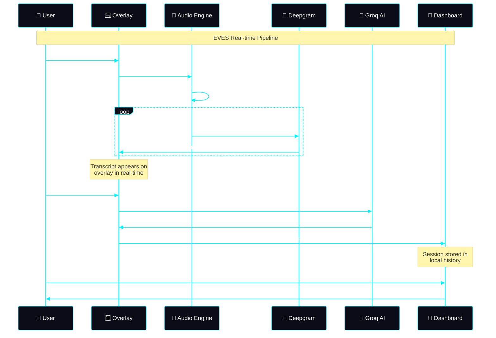

<p align="center">
  <a href="https://github.com/SHAILESH-RS-UPADHYAY/eves">
    
  </a>
</p>

<p align="center">
  <a href="#"></a>
  <a href="#"></a>
  <a href="#"></a>
  <a href="#"></a>
  <a href="#"></a>
  <a href="LICENSE"></a>
</p>

<br/>

<!-- ASCII ART HEADER -->
<pre align="center" style="font-family: 'Courier New', monospace; background: #0c0c18; color: #00F5FF; padding: 20px; border-radius: 8px; border: 1px solid rgba(0,245,255,0.2); line-height: 1.2;">
╔══════════════════════════════════════════════════════════════════╗
║                                                                  ║
║      ███████╗██╗   ██╗███████╗███████╗                          ║
║      ██╔════╝██║   ██║██╔════╝██╔════╝                          ║
║      █████╗  ██║   ██║█████╗  ███████╗                          ║
║      ██╔══╝  ╚██╗ ██╔╝██╔══╝  ╚════██║                          ║
║      ███████╗ ╚████╔╝ ███████╗███████║                          ║
║      ╚══════╝  ╚═══╝  ╚══════╝╚══════╝                          ║
║                                                                  ║
║      ███╗   ███╗███████╗███████╗████████╗██╗███╗   ██╗ ██████╗  ║
║      ████╗ ████║██╔════╝██╔════╝╚══██╔══╝██║████╗  ██║██╔════╝  ║
║      ██╔████╔██║█████╗  █████╗     ██║   ██║██╔██╗ ██║██║  ███╗ ║
║      ██║╚██╔╝██║██╔══╝  ██╔══╝     ██║   ██║██║╚██╗██║██║   ██║ ║
║      ██║ ╚═╝ ██║███████╗███████╗   ██║   ██║██║ ╚████║╚██████╔╝ ║
║      ╚═╝     ╚═╝╚══════╝╚══════╝   ╚═╝   ╚═╝╚═╝  ╚═══╝ ╚═════╝  ║
║                                                                  ║
║      MEETING INTELLIGENCE SYSTEM  ◆  v2.1.0                      ║
║                                                                  ║
║      [ stealth ]  [ ai-powered ]  [ real-time ]  [ local ]      ║
║                                                                  ║
╚══════════════════════════════════════════════════════════════════╝
</pre>

<br/>

<!-- ANIMATED VISUAL HEADER SVG -->
<div align="center">
  <svg xmlns="http://www.w3.org/2000/svg" viewBox="0 0 800 240" width="100%" style="max-width: 800px; border-radius: 12px; border: 1px solid rgba(0,245,255,0.15); background: #0c0c18;">
    <defs>
      <linearGradient id="glowGrad" x1="0" y1="0" x2="1" y2="1">
        <stop offset="0%" stop-color="#00F5FF" />
        <stop offset="50%" stop-color="#10B981" />
        <stop offset="100%" stop-color="#00F5FF" />
      </linearGradient>
      <pattern id="grid" width="30" height="30" patternUnits="userSpaceOnUse">
        <circle cx="15" cy="15" r="0.8" fill="rgba(0,245,255,0.06)" />
      </pattern>
      <filter id="glow">
        <feGaussianBlur stdDeviation="6" result="blur" />
        <feMerge>
          <feMergeNode in="blur" />
          <feMergeNode in="SourceGraphic" />
        </feMerge>
      </filter>
    </defs>

    <style>
      @keyframes pulseGlow {
        0%, 100% { opacity: 0.6; }
        50% { opacity: 1; }
      }
      @keyframes scanline {
        0% { transform: translateY(-240px); }
        100% { transform: translateY(480px); }
      }
      @keyframes blink {
        0%, 50% { opacity: 1; }
        51%, 100% { opacity: 0; }
      }
      @keyframes float {
        0%, 100% { transform: translateY(0); }
        50% { transform: translateY(-4px); }
      }
      .glow-text { animation: pulseGlow 2.5s ease-in-out infinite; }
      .scan { animation: scanline 4s linear infinite; }
      .blink { animation: blink 1s step-end infinite; }
      .float { animation: float 3s ease-in-out infinite; }
      .corner { stroke: rgba(0,245,255,0.4); fill: none; }
    </style>

    <rect width="800" height="240" fill="#0c0c18" rx="12" />
    <rect width="800" height="240" fill="url(#grid)" rx="12" />

    <!-- Scanline -->
    <rect class="scan" width="800" height="80" fill="url(#glowGrad)" opacity="0.03" rx="12" />

    <!-- Corner brackets -->
    <polyline class="corner" points="10,10 10,30 10,10 30,10" stroke="#00F5FF" stroke-width="1.5" />
    <polyline class="corner" points="790,10 790,30 790,10 770,10" stroke="#00F5FF" stroke-width="1.5" />
    <polyline class="corner" points="10,230 10,210 10,230 30,230" stroke="#00F5FF" stroke-width="1.5" />
    <polyline class="corner" points="790,230 790,210 790,230 770,230" stroke="#00F5FF" stroke-width="1.5" />

    <!-- Status line top -->
    <text x="20" y="30" fill="rgba(0,245,255,0.3)" font-family="'Courier New', monospace" font-size="9">evessys@localhost</text>
    <text x="200" y="30" fill="rgba(255,255,255,0.15)" font-family="'Courier New', monospace" font-size="9">:</text>
    <text x="210" y="30" fill="rgba(167,139,250,0.3)" font-family="'Courier New', monospace" font-size="9">~</text>
    <text x="225" y="30" fill="rgba(255,255,255,0.15)" font-family="'Courier New', monospace" font-size="9">$</text>
    <text x="240" y="30" fill="rgba(16,185,129,0.2)" font-family="'Courier New', monospace" font-size="9">./eves --init --stealth</text>

    <!-- Online indicator -->
    <circle cx="740" cy="26" r="4" fill="#10B981" opacity="0.8" filter="url(#glow)">
      <animate attributeName="opacity" values="0.8;0.4;0.8" dur="2s" repeatCount="indefinite" />
    </circle>
    <text x="755" y="30" fill="#10B981" font-family="'Courier New', monospace" font-size="10" font-weight="bold" opacity="0.8">ONLINE</text>

    <!-- EVES Main Text -->
    <text class="glow-text float" x="400" y="120" text-anchor="middle" fill="#00F5FF" font-family="'Courier New', monospace" font-size="60" font-weight="bold" filter="url(#glow)" letter-spacing="8">EVES</text>

    <!-- Subtitle -->
    <text x="400" y="155" text-anchor="middle" fill="rgba(0,245,255,0.5)" font-family="'Courier New', monospace" font-size="12" letter-spacing="4">MEETING INTELLIGENCE SYSTEM</text>

    <!-- Tags -->
    <rect x="240" y="175" width="60" height="16" rx="3" fill="rgba(0,245,255,0.1)" stroke="rgba(0,245,255,0.2)" stroke-width="0.5"/>
    <text x="270" y="187" text-anchor="middle" fill="rgba(0,245,255,0.6)" font-family="'Courier New', monospace" font-size="8" font-weight="bold">STEALTH</text>

    <rect x="310" y="175" width="60" height="16" rx="3" fill="rgba(16,185,129,0.1)" stroke="rgba(16,185,129,0.2)" stroke-width="0.5"/>
    <text x="340" y="187" text-anchor="middle" fill="rgba(16,185,129,0.6)" font-family="'Courier New', monospace" font-size="8" font-weight="bold">AI-POWERED</text>

    <rect x="380" y="175" width="70" height="16" rx="3" fill="rgba(0,245,255,0.1)" stroke="rgba(0,245,255,0.2)" stroke-width="0.5"/>
    <text x="415" y="187" text-anchor="middle" fill="rgba(0,245,255,0.6)" font-family="'Courier New', monospace" font-size="8" font-weight="bold">REAL-TIME</text>

    <rect x="460" y="175" width="50" height="16" rx="3" fill="rgba(16,185,129,0.1)" stroke="rgba(16,185,129,0.2)" stroke-width="0.5"/>
    <text x="485" y="187" text-anchor="middle" fill="rgba(16,185,129,0.6)" font-family="'Courier New', monospace" font-size="8" font-weight="bold">LOCAL</text>

    <rect x="520" y="175" width="50" height="16" rx="3" fill="rgba(245,158,11,0.1)" stroke="rgba(245,158,11,0.2)" stroke-width="0.5"/>
    <text x="545" y="187" text-anchor="middle" fill="rgba(245,158,11,0.6)" font-family="'Courier New', monospace" font-size="8" font-weight="bold">v2.1</text>

    <!-- Bottom status line -->
    <text x="20" y="222" fill="rgba(0,245,255,0.2)" font-family="'Courier New', monospace" font-size="8">$ ./eves --status</text>
    <text x="680" y="222" fill="rgba(0,245,255,0.2)" font-family="'Courier New', monospace" font-size="8">Press 'Ctrl+Shift+D' to enter</text>
  </svg>
</div>

<br/>

---

## ▌ OVERVIEW

**EVES** is a next-generation desktop intelligence system that listens to your meetings — both online (Google Meet, Zoom, Teams) and physical (classroom, conference) — and transcribes them in real time using Deepgram's nova-2 engine, then extracts decisions, intent, and action items via Groq's LLaMA-3 70B.

It runs **entirely on your machine**. No cloud. No subscriptions. No one can see it on screen share. They'll never know you're profiling the conversation.

```bash
# ./eves --why
  [✓] Private — everything stays local
  [✓] Invisible — no one knows it's running
  [✓] Accurate — 95%+ transciption via Deepgram nova-2
  [✓] Intelligent — intent extraction via Groq LLaMA-3 70B
  [✓] Real-time — live transcript as you speak
  [✓] Dual audio — internal system audio + external mic
```

---

## ▌ FEATURES

```
▸ AI TRANSCRIPTION    Deepgram nova-2 captures every word with 95%+ accuracy,
 │                    speaker diarization, smart formatting, real-time streaming.
 │
▸ INTENT EXTRACTION   Groq LLaMA-3 70B extracts decisions, hidden agendas,
 │                    action items, and what was left unsaid.
 │
▸ STEALTH MODE       Uses Windows SetWindowDisplayAffinity to hide from screen
 │                    share, OBS, screenshots. Removed from taskbar + Alt+Tab.
 │
▸ DUAL AUDIO CAPTURE  Internal loopback (system audio) + external microphone
 │                    toggle. Runtime source switching with Ctrl+Shift+O.
 │
▸ SESSION HISTORY     Full transcripts with AI summaries saved to dashboard.
 │                    Ctrl+Space to save — appears in both overlay + dashboard.
 │
▸ NOTION EXPORT       One-click export to structured Notion pages with all
                      insights, action items, and speaker analysis.
```

---

## ▌ SYSTEM ARCHITECTURE

```mermaid
%%{init: {'theme': 'base', 'themeVariables': { 'fontFamily': 'Courier New', 'primaryColor': '#00F5FF', 'primaryTextColor': '#fff', 'primaryBorderColor': '#00F5FF', 'lineColor': '#00F5FF', 'secondaryColor': '#0c0c18', 'tertiaryColor': '#06060c', 'background': '#0c0c18', 'mainBkg': '#0c0c18', 'nodeBorder': '#00F5FF', 'clusterBkg': '#0c0c18', 'clusterBorder': 'rgba(0,245,255,0.15)', 'titleColor': '#00F5FF', 'edgeLabelBackground': '#0c0c18'}}}%%
graph TB
    subgraph LAUNCHER["🎬 Launch"]
        direction TB
        V["start.vbs"] --> H["start.hta"]
        B["Launch EVES.bat"] --> E["electron-vite dev"]
        H --> E
        style LAUNCHER fill:#0c0c18,stroke:#00F5FF,stroke-width:1
    end

    subgraph ELECTRON["⚡ Electron Main Process"]
        direction LR
        M["Main Window<br/>(React Dashboard)"] --> IPC["IPC Bridge"]
        O["Overlay Window<br/>(HTML + JS)"] --> IPC
        style ELECTRON fill:#0c0c18,stroke:#00F5FF,stroke-width:1
    end

    subgraph AUDIO["🎙️ Audio Pipeline"]
        direction LR
        A["Audio Capture"] --> I["Internal Loopback<br/>getDisplayMedia"]
        A --> X["External Mic<br/>getUserMedia"]
        I --> D["Deepgram WebSocket<br/>wss://api.deepgram.com"]
        X --> D
        D --> T["Live Transcript<br/>16kHz PCM"]
        style AUDIO fill:#0c0c18,stroke:#00F5FF,stroke-width:1
    end

    subgraph AI["🧠 AI Processing"]
        G["Groq LLaMA-3 70B"] --> S["Summary"]
        G --> I2["Intent Extraction"]
        G --> A2["Action Items"]
        style AI fill:#0c0c18,stroke:#00F5FF,stroke-width:1
    end

    subgraph STEALTH["🕵️ Stealth Layer"]
        C["setContentProtection<br/>WDA_EXCLUDEFROMCAPTURE"] --> T2["Invisible to Screen Share"]
        N["skipTaskbar + WS_EX_TOOLWINDOW"] --> T2
        K["setIgnoreMouseEvents<br/>Click-through"] --> T2
        style STEALTH fill:#0c0c18,stroke:#00F5FF,stroke-width:1
    end

    E --> M
    E --> O
    O --> A
    T --> O
    O --> G
    G --> M
    M --> H2["Session History"]
    M --> P["Notion Export"]
```



---

## ▌ AUDIO PIPELINE



---

## ▌ QUICK START

```bash
# 1. Clone the repository
git clone https://github.com/SHAILESH-RS-UPADHYAY/eves.git
cd eves

# 2. Install dependencies
npm install

# 3. Launch EVES
npm run dev
# Both windows appear:
#   Dashboard at center  →  Press Ctrl+Shift+D to focus
#   Overlay top-right    →  Press Ctrl+Shift+L to start listening

# Alternative: Double-click 'Launch EVES.bat'
# or: Double-click 'start.vbs' → animated launcher appears
```

### Get API Keys

| Service | Purpose | Get Key |
|---------|---------|---------|
| **Deepgram** | Real-time transcription (nova-2) | https://console.deepgram.com |
| **Groq** | AI summarization + intent (LLaMA-3) | https://console.groq.com |

> Enter both keys in **Settings → API Keys** inside the dashboard. They persist across restarts.

---

## ▌ OVERLAY HOTKEYS

```
┌─────────────────────────────────────────────────────────────────┐
│                        KEY BINDINGS                             │
├──────────────────────────────────┬──────────────────────────────┤
│  Ctrl + Shift + L                │  Start / Stop Listening      │
│  Ctrl + Shift + H                │  Hide Overlay (listen keeps) │
│  Ctrl + Shift + O                │  Toggle Audio Source          │
│  Ctrl + Shift + T                │  Toggle Click-Through         │
│  Ctrl + Shift + D                │  Show / Hide Dashboard        │
│  Ctrl + Shift + S                │  Toggle Stealth Mode          │
│  Ctrl + Space                    │  Save Session to History      │
│  Ctrl + Shift + X                │  Quit EVES                    │
└──────────────────────────────────┴──────────────────────────────┘
```

---

## ▌ HOW IT WORKS

```
┌─────────────────────────────────────────────────────────────────────┐
│                                                                     │
│  1. LAUNCH EVES                                                     │
│     └─ Overlay appears top-right (futuristic glass HUD panel)       │
│     └─ Dashboard opens centered (hacker command center)             │
│                                                                     │
│  2. START LISTENING (Ctrl+Shift+L)                                  │
│     └─ Choose audio source: Internal (system) / External (mic)      │
│     └─ Live transcript streams onto the overlay panel               │
│     └─ Audio levels animate the orb and equalizer bars              │
│                                                                     │
│  3. SAVE SESSION (Ctrl+Space)                                       │
│     └─ Full transcript sent to Groq for AI processing               │
│     └─ Groq returns: summary + intent extraction + action items     │
│     └─ Session saved to dashboard history                           │
│                                                                     │
│  4. REVIEW IN DASHBOARD (Ctrl+Shift+D)                              │
│     └─ Browse all past sessions with AI summaries                   │
│     └─ Search transcripts, filter by source, date                   │
│     └─ Export to Notion for team collaboration                      │
│                                                                     │
│  5. STEALTH MODE (Auto-activated)                                   │
│     └─ Overlay invisible in screen shares (Zoom, Meet, Teams)       │
│     └─ No taskbar icon, no Alt+Tab entry                            │
│     └─ Click-through: mouse passes through when not hovering        │
│                                                                     │
└─────────────────────────────────────────────────────────────────────┘
```

---

## ▌ SCREENSHOTS

<p align="center">
  <table>
    <tr>
      <td align="center"><strong>Boot Sequence</strong></td>
      <td align="center"><strong>Hacker Dashboard</strong></td>
    </tr>
    <tr>
      <td>
        <pre style="background: #0c0c18; border: 1px solid rgba(0,245,255,0.15); border-radius: 8px; padding: 20px; color: #10B981; font-family: 'Courier New', monospace; line-height: 1.5;">
$ ./eves --init --stealth
Initializing neural core...     [OK]
Loading Deepgram nova-2...      [OK]
Loading Groq LLaMA-3 70B...     [OK]
Mounting audio drivers...       [OK]
Activating stealth module...    [OK]
Registering hotkeys...          [OK]
▊</pre>
      </td>
      <td>
        <pre style="background: #0c0c18; border: 1px solid rgba(0,245,255,0.15); border-radius: 8px; padding: 20px; color: #00F5FF; font-family: 'Courier New', monospace; line-height: 1.5;">
▌ EVES :: MEETING INTELLIGENCE    [● ONLINE]

┌ SYSTEM STATUS ┐  ┌ YOUR MEETINGS. ┐
│ CPU: 23%  ████ │  │    HACKED.     │
│ MEM: 48%  ████ │  │                │
│ NET: 12%  ██   │  │ [▶ LAUNCH EVES]│
│ AUDIO: ▁▂▃▅▇ │  └────────────────┘
└───────────────┘</pre>
      </td>
    </tr>
    <tr>
      <td align="center"><strong>Overlay Panel</strong></td>
      <td align="center"><strong>History Side Panel</strong></td>
    </tr>
    <tr>
      <td>
        <pre style="background: rgba(6,8,14,0.8); border: 1px solid rgba(0,245,255,0.2); border-radius: 10px; padding: 20px; color: #00F5FF; font-family: 'Courier New', monospace; line-height: 1.5;">
╔══════════════════════╗
║  EVES v2.1  [STEALTH]║
║                      ║
║       ◉ LISTENING    ║
║      03:45           ║
║                      ║
║  ▸ AUDIO_SOURCE      ║
║  [INT] [EXT]         ║
║                      ║
║  [▶ EXECUTE_LISTEN]  ║
║                      ║
║  ▸ LIVE_FEED         ║
║  "hello everyone..." ▊║
║                      ║
║  L H ␣          [≡]  ║
╚══════════════════════╝</pre>
      </td>
      <td>
        <pre style="background: rgba(6,8,14,0.8); border: 1px solid rgba(0,245,255,0.2); border-radius: 10px; padding: 20px; color: #00F5FF; font-family: 'Courier New', monospace; line-height: 1.5;">
╔══════════════════════╗
║ ▸ SESSION_LOG    [✕] ║
║──────────────────────║
║ ▼ Today 2:30 PM      ║
║   Meeting about Q3.. ║
║   [INT] 45min        ║
║──────────────────────║
║ ▼ Today 10:15 AM     ║
║   Class lecture OS.. ║
║   [EXT] 20min        ║
║──────────────────────║
║ $ No more sessions   ║
║ ▊                    ║
╚══════════════════════╝</pre>
      </td>
    </tr>
  </table>
</p>

---

## ▌ TECH STACK

```
┌─────────────────────────────────────────────────────────────────┐
│                       TECHNOLOGY LAYER                          │
├──────────────────────┬──────────────────────────────────────────┤
│  Desktop Framework   │  Electron 32                             │
│  Frontend            │  React 18 + TypeScript 5                 │
│  Build System        │  electron-vite + Vite 5                  │
│  Styling             │  CSS Custom Properties + Tailwind 3       │
│  Animation           │  Framer Motion 11 + CSS Keyframes        │
│  State Management    │  Zustand 5                               │
│  Data Fetching       │  TanStack Query 5                        │
│  Charts              │  Recharts 2                              │
│  Audio Visualization │  WaveSurfer.js 7                         │
│  Transcription       │  Deepgram SDK 3 (nova-2, WebSocket)       │
│  AI Processing       │  Groq SDK (LLaMA-3 70B)                  │
│  Icons               │  Lucide React                            │
│  Notion Export       │  Notion MCP API                          │
│  Storage             │  conf 10 (local encrypted config)        │
└──────────────────────┴──────────────────────────────────────────┘
```

---

## ▌ PROJECT STRUCTURE

```
eves/
├── electron/
│   ├── main.ts              # Main process — dual-window, hotkeys, IPC, stealth
│   ├── preload.ts           # Context bridge — overlay + dashboard APIs
│   ├── ipc/                 # IPC handlers (deepgram, groq, drive, notion, settings)
│   ├── utils/               # Utilities (stealth manager, store, bounds)
│   └── icons/               # App icons
│
├── src/
│   ├── components/
│   │   ├── dashboard/       # Dashboard page + stats + feed + insights
│   │   ├── hacker/          # MatrixRain, Scanlines, BootSequence, SystemStatus
│   │   │                    # LiveLogFeed, GlitchText, RadarSweep, HackerImage
│   │   ├── layout/          # AppShell, Sidebar, TopBar
│   │   ├── glass/           # GlassCard, GlassButton, GlassBadge
│   │   ├── meeting/         # MeetingPage, TranscriptView
│   │   ├── settings/        # SettingsModal
│   │   ├── integrations/    # DriveSync, NotionExport
│   │   ├── command/         # CommandPalette
│   │   └── extras/          # CursorGlow, ToastSystem, EmptyState
│   ├── store/               # Zustand stores (ui, meetings, settings)
│   ├── hooks/               # Custom hooks (stealth, shortcuts)
│   ├── services/            # API service modules
│   ├── styles/              # Global CSS with hacker design tokens
│   └── types/               # TypeScript definitions
│
├── overlay/
│   ├── index.html           # Overlay HTML — hacker terminal HUD
│   ├── styles.css           # Overlay styles — cyan/green scanline aesthetic
│   └── app.js               # Overlay logic — audio capture, IPC, history
│
├── start.hta                # Animated HTA launcher (scanline + grid glow)
├── start.vbs                # VBS stealth launcher (silent)
├── Launch EVES.bat          # Batch launcher with terminal header
├── stop.bat                 # Kill all EVES processes
└── package.json             # Dependencies & scripts
```

---

## ▌ STEALTH & PRIVACY

EVES employs multiple layers of stealth to remain undetectable during meetings:

| Technique | Implementation | Purpose |
|-----------|---------------|---------|
| **Screen capture exclusion** | `SetWindowDisplayAffinity(WDA_EXCLUDEFROMCAPTURE)` | Invisible in OBS, Zoom, Meet, Teams screen shares |
| **Taskbar hiding** | `skipTaskbar: true` + `type: 'toolbar'` | No icon appears in Windows taskbar |
| **Alt+Tab exclusion** | `WS_EX_TOOLWINDOW` extended style | Not listed in Alt+Tab switcher |
| **Click-through mode** | `setIgnoreMouseEvents(true, { forward: true })` | Mouse passes through when not hovering |
| **Content protection** | `setContentProtection(true)` | Screenshot tools capture a blank window |

> All processing happens **locally on your machine**. Audio is streamed to Deepgram for transcription only — no permanent cloud storage.

---

## ▌ CONTRIBUTING

```bash
# Fork the repository
# Create a feature branch
git checkout -b feat/amazing-feature

# Make your changes and test
npm run dev

# Submit a pull request
git push origin feat/amazing-feature
```

---

## ▌ LICENSE

This project is licensed under the MIT License — see the [LICENSE](LICENSE) file for details.

---

<p align="center">
  <sub style="font-family: 'Courier New', monospace; color: rgba(255,255,255,0.2);">
    MIT License — Personal use only.
  </sub>
</p>

<p align="center">
  <a href="#">
    
  </a>
</p>
