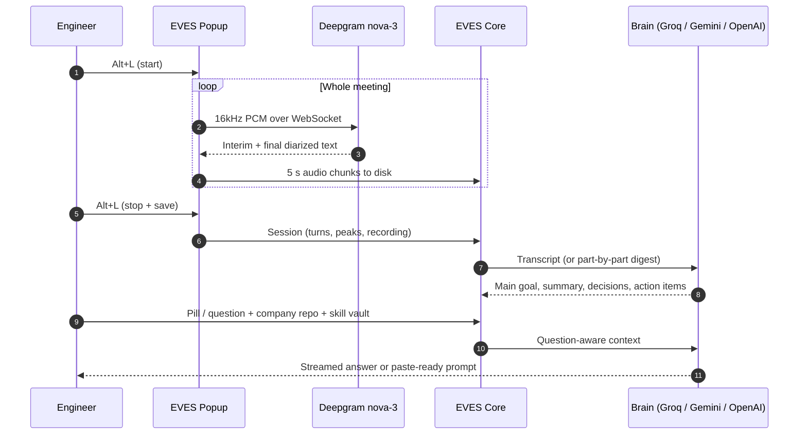

<p align="center"></p>

# EVES — Meeting Intelligence & Context-to-Code Pipeline

<div align="center">


<br/>

**A personal desktop application built with React, Node.js, and TypeScript that records long engineering meetings, transcribes them live (mixed Hindi-English included), and turns them into a mission brief, a chat you can question, and production-grade prompts for Codex, Claude Code and Cursor.**

</div>

<picture>
  <source media="(max-width: 600px) and (prefers-color-scheme: dark)" srcset="https://shailesh-stats.vercel.app/api/plate?name=repo&amp;repo=eves&amp;theme=dark&amp;w=m">
  <source media="(max-width: 600px)" srcset="https://shailesh-stats.vercel.app/api/plate?name=repo&amp;repo=eves&amp;theme=light&amp;w=m">
  <source media="(prefers-color-scheme: dark)" srcset="https://shailesh-stats.vercel.app/api/plate?name=repo&amp;repo=eves&amp;theme=dark">
  
</picture>

---

## ▌ Overview

When collaborating remotely, architecture reviews and technical syncs pack a tremendous amount of context into calls that often run past two hours: subtle design trade-offs, constraints, explicit non-goals, and implementation nuances.

While it's easy to remember the high-level instruction, the critical engineering reasoning often gets lost between the call and the keyboard. Asking senior leads to re-explain things doesn't scale and consumes valuable engineering time.

**EVES** was built to eliminate this friction. A floating popup captures system audio and/or your mic, streams it to Deepgram for real-time diarized transcription and keeps the full recording on disk. Its brain — **Groq, Gemini (AI Studio) or OpenAI**, your choice — summarises the meeting (part by part when it is hours long), then answers "what exactly do I build, and how?" against your **company repository** and your **skill vault**, and writes paste-ready prompts for your AI coding tool.

---

## ▌ Core Philosophy: "Summary is Passive, Prompt is Actionable"

Most meeting tools generate generic prose summaries that are read once and forgotten. EVES approaches meeting context from an engineer's workflow perspective:

1. **Structured Engineering Brief**:
   - **Main Goal**: the one outcome the meeting is really about ("what exactly needs to be done").
   - **Decisions Made**: Concrete technical choices agreed upon during the call, with timestamps.
   - **Deliberately Avoided**: Approaches or libraries explicitly ruled out and why.
   - **Action Items & Owners**: Clear, attributable deliverables with deadlines.

2. **Production-Grade Prompt Composition**:
   - Translates meeting context into a structured, constraint-packed prompt for Codex, Claude Code or Cursor.
   - Always opens with your repository path and your skill vault (catalog + which skills to load), in WSL or Windows path format.
   - Carries the codebase map, plan, **what the finished screen looks like**, acceptance criteria and verification commands.
   - Shifts the developer's role from **reconstructing requirements** to **supervising and directing implementation**.

---

## ▌ Meeting → Mission Workflow

1. **Record** — `Alt + L` in the EVES popup (INT = meeting audio, EXT = your mic, BOTH = both). The recording is written to disk every 5 s and the transcript streams live.
2. **Save** — stop with `Alt + L` / `Alt + Space`. The popup offers **OPEN IN BRAIN ›**. With auto-analyze on, the summary starts immediately.
3. **Listen back** — Meetings page: instant waveform, any speed from 0.5× to 3× (pitch preserved), click a word to jump there.
4. **Ask** — EVES Brain page: attach your **company repo** and **skill vault** once (they're remembered), then chat with it, by typing or by voice.
5. **Pills** — MAIN GOAL · HOW TO BUILD · CODEX PROMPT · CLAUDE CODE PROMPT · CURSOR PROMPT · FRONTEND PREVIEW · ACTION PLAN · RISKS & QUESTIONS. Click one or just say it ("codex prompt").
6. **Paste** — copy the prompt capsule into your tool. FRONTEND PREVIEW also renders a live mock of the finished screen.

---

## ▌ Architecture & Data Flow

```
┌──────────────────┐   16kHz PCM (WebSocket)   ┌──────────────────────┐
│   EVES Popup     │ ────────────────────────> │ Deepgram nova-3      │
│ Loopback + Mic   │                           │ live, diarized,      │
│ 32 kbps Opus rec │                           │ multilingual         │
└────────┬─────────┘                           └──────────┬───────────┘
         │ recording + transcript + peaks                  │ turns [mm:ss] S1…
         ▼                                                 ▼
┌──────────────────────────────────────────────────────────────────────┐
│ EVES Core — one JSON file per meeting · range-streamed recordings    │
│ Brain: digest long meetings → analysis → chat → prompt pills         │
│ Context: transcript + company repo index + skill vault catalog       │
└────────┬──────────────────────────────────────────┬──────────────────┘
         ▼                                          ▼
┌──────────────────┐                     ┌─────────────────────────────┐
│ Dashboard        │                     │ Groq · Gemini · OpenAI      │
│ Brain · Player   │                     │ (OpenAI-compatible API,     │
│ Repo Intel       │                     │  auto-switches retired      │
└──────────────────┘                     │  models)                    │
                                         └─────────────────────────────┘
```

### End-to-End Pipeline



---

## ▌ Key Capabilities

- **Long-Meeting Capture**: System loopback and mic, summed into one 32 kbps Opus recording written to disk as it happens (a crash costs ≤ 5 s). Wall-clock timer, no background throttling, reconnect-safe timestamps — built for 2h+ meetings.
- **Streaming Transcription & Speaker Diarization**: Deepgram nova-3 `multi` handles Hindi ↔ English in one sentence; speaker turns are merged cleanly and timestamped.
- **Any-Speed Playback**: Recorded meetings open instantly from captured peaks and stream with HTTP range seeks; 0.5×–3× with pitch preserved; keyboard: Space, ←/→, `[`/`]`.
- **Three Brains**: Groq (fastest), Gemini (1M-token context — best for very long meetings), OpenAI (Codex family). One client, live model lists, automatic switch when a provider retires a model.
- **EVES Brain Chat**: Answers grounded in the transcript, the company repo index (stack, scripts, agent rules, relevant files) and the skill vault catalog; cites `[mm:ss]`; always answers in English.
- **Spatial Prompt Pills**: Eight neon glass pills with 3D tilt, one tap or one spoken phrase each.
- **Skill Vault**: Attach a reference repo (e.g. `github_skills`); its `INDEX.md` is read on every prompt and the right skill paths are named for the coding agent.
- **Local-First & Private**: Keys, transcripts and audio stay on your machine; calls go directly to Deepgram and your chosen provider.
- **Team Knowledge Base Sync**: Export to Notion and Google Drive.

---

## ▌ Keyboard Shortcuts

| Shortcut | Action | Description |
|:---|:---|:---|
| `Alt + D` | **Toggle Dashboard** | Open or hide the main EVES dashboard |
| `Alt + L` | **Start / Stop Listening** | Toggles capture (opens the popup if needed) |
| `Alt + Backspace` | **Hide / Show EVES Popup** | Hidden popup keeps recording |
| `Alt + O` | **Cycle Audio Source** | INT → EXT → BOTH |
| `Alt + T` | **Toggle Click-Through** | Mouse passes through the popup |
| `Alt + Space` | **Stop + Save Session** | Ends the recording and saves it |
| `Alt + Q` | **Quit Application** | Gracefully closes EVES |

---

## ▌ Technical Stack

| Layer | Technologies |
|:---|:---|
| **Desktop Shell** | Node.js · TypeScript 5.5 · Native Core |
| **Frontend UI** | React 18 · Framer Motion · Lucide Icons · hand-tuned CSS |
| **Speech-to-Text** | Deepgram nova-3 / nova-2 (`@deepgram/sdk` for files, WebSocket for live) |
| **AI Brain** | Groq · Gemini · OpenAI over one OpenAI-compatible `fetch` client (no SDKs) |
| **State Management** | Zustand 5 (client state) · Conf (preferences) · per-meeting JSON files |
| **Audio Processing** | Web Audio API · MediaRecorder (Opus) · wavesurfer.js |
| **Integrations** | Notion · Google Drive |

---

## ▌ Project Structure

```
eves/
├── core/                         # Desktop core process
│   ├── runtime.ts                # The single boundary to the desktop runtime package
│   ├── main.ts                   # Lifecycle, windows (dashboard + popup), tray, hotkeys
│   ├── preload.ts                # Context bridge (window.eves.*)
│   ├── icon.ts                   # EVES sigil for tray + taskbar
│   ├── ipc/                      # ai · deepgram · meetings · recorder · repo · settings · drive · notion
│   └── utils/                    # llm (client) · brain (prompts/context) · meetings (storage) · store · audioUrl
│                                 # + *.test.mts self-checks
├── popup/                        # The floating EVES popup (capture, live feed, recorder)
├── src/                          # Dashboard (React + TS)
│   ├── components/brain/         # EVES Brain page, spatial pills, chat, Markdown
│   ├── components/…              # dashboard, meeting, repo, settings, hacker UI
│   ├── hooks/                    # analyze, brain chat, voice input, repo link, transcription
│   ├── lib/                      # providers, paths, speech (shared), markdown parser
│   ├── store/                    # Zustand stores (meetings, repo, settings, ui)
│   └── types/                    # Shared TypeScript interfaces
├── launcher/                     # Startup scripts
├── eves.config.ts                # Build config
├── packager.yml                  # Installer config
└── EVES_TRACKER.md               # What changed, where and why — phase by phase
```

---

## ▌ Getting Started

### 1. Prerequisites

- [Node.js](https://nodejs.org/) v22.18 or later (the self-checks run TypeScript directly)
- [Deepgram API Key](https://console.deepgram.com/) — transcription
- One AI key: [Groq](https://console.groq.com/keys), [Gemini / AI Studio](https://aistudio.google.com/apikey) or [OpenAI](https://platform.openai.com/api-keys)

### 2. Installation

```bash
# Clone repository
git clone https://github.com/SHAILESH-RS-UPADHYAY/eves.git
cd eves

# Install dependencies
npm install
```

### 3. Launching EVES

You can launch EVES via npm or with the included launchers:

- **Launch Dashboard Directly**: Double-click `launcher/Launch Dashboard.bat` or run:
  ```bash
  npm run dashboard
  ```
- **Launch Standard Service** (popup first): Double-click `launcher/Launch EVES.bat` or run:
  ```bash
  npm start
  ```
- **GUI Launcher**: Double-click `launcher/start.hta` to access the interactive start menu (`./open_dashboard`, `./start_eves`, `./kill_eves`).

### 4. Configure Keys and the Brain

1. Open **Settings** (dashboard `api_keys`, or Control Panel → `EDIT_CONFIG`).
2. **API Keys**: paste Deepgram + at least one AI key; **Test** checks each for real.
3. **Brain**: pick the provider and prompt path format (WSL / Windows).
4. **EVES Brain page**: attach your company repo and your skill vault — both are remembered.

### 5. Checks and Build

```bash
npm test          # self-checks: audio URLs/ranges, LLM client, brain logic, Markdown parser
npm run build     # compile all bundles
npm run package   # platform installer
```

---

## ▌ Privacy & Security

- **Direct API Connections**: Audio streams directly from your client to Deepgram; text goes directly to the AI provider you choose. No intermediary backend or analytics servers.
- **Local Storage**: Meetings (one JSON file each), recordings and settings live in your local application data directory — Settings → Storage opens the folders.
- **Repository Safety**: Only source-like files are ever read into a prompt; files that look like secrets (`.env`, tokens, service accounts, databases) never are.
- **Team Transparency**: EVES is designed as an engineering productivity assistant. Transcripts and briefs can be reviewed and pushed to team documentation (Notion / Google Drive) for transparent team record-keeping.

---

## ▌ License

MIT License. Designed and developed by [Shailesh Upadhyay](https://github.com/SHAILESH-RS-UPADHYAY).
