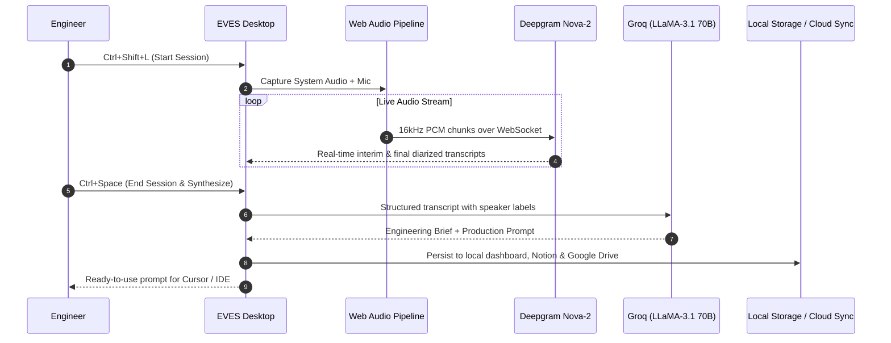

# EVES — Meeting Intelligence & Context-to-Code Pipeline

<div align="center">


<br/>

**A personal desktop application built with React, Node.js, and TypeScript to capture remote engineering meetings, transcribe live audio with speaker diarization, and generate actionable technical briefs and production-grade LLM prompts.**

</div>

---

## ▌ Overview

When collaborating remotely, architecture reviews and technical syncs pack a tremendous amount of context into 30-minute calls: subtle design trade-offs, constraints, explicit non-goals, and implementation nuances. 

While it's easy to remember the high-level instruction, the critical engineering reasoning often gets lost between the call and the keyboard. Asking senior leads to re-explain things doesn't scale and consumes valuable engineering time.

**EVES** was built to eliminate this friction. It runs locally as a companion app during technical calls, captures dual-channel audio, streams it to Deepgram for real-time diarized transcription, and leverages Groq's high-speed LLaMA-3.1 70B inference to produce structured engineering briefs and ready-to-use prompts for AI coding tools like Cursor.

---

## ▌ Core Philosophy: "Summary is Passive, Prompt is Actionable"

Most meeting tools generate generic prose summaries that are read once and forgotten. EVES approaches meeting context from an engineer's workflow perspective:

1. **Structured Engineering Brief**:
   - **Decisions Made**: Concrete technical choices agreed upon during the call.
   - **Deliberately Avoided**: Approaches or libraries explicitly ruled out and why.
   - **Underlying Intent**: The motivation behind architectural requests, not just literal statements.
   - **Action Items & Owners**: Clear, attributable deliverables with context.

2. **Production-Grade Prompt Composition**:
   - Automatically translates meeting context into a structured, constraint-packed prompt.
   - Ready to drop into Cursor, Claude, or Codex.
   - Carries architectural intent, acceptance criteria, and edge cases so the AI gets code right on the first try.
   - Shifts the developer's role from **reconstructing requirements** to **supervising and directing implementation**.

---

## ▌ Architecture & Data Flow

```
┌──────────────────┐       16kHz PCM Stream       ┌──────────────────┐
│  Audio Capture   │ ───────────────────────────> │  Deepgram Nova-2 │
│ (Loopback + Mic) │       WebSocket API          │ (Live Diarized)  │
└──────────────────┘                              └─────────┬────────┘
                                                            │ Live Transcript
                                                            ▼
┌──────────────────┐       Fast Inference         ┌──────────────────┐
│ Local Dashboard  │ <─────────────────────────── │  Groq LLaMA-3.1  │
│  & History Store │   Brief + Cursor Prompt      │       70B        │
└────────┬─────────┘                              └──────────────────┘
         │
         ├──▶ Notion Workspace Sync
         └──▶ Google Drive Archive
```

### End-to-End Pipeline



---

## ▌ Key Capabilities

- **Dual-Channel Audio Capture**: Uses the Web Audio API and desktop capture loopback to record incoming system audio (remote voices) and microphone audio simultaneously downsampled to 16kHz PCM.
- **Streaming Transcription & Speaker Diarization**: Deepgram Nova-2 WebSocket integration streams live transcripts with low latency and tags speaker changes so you know who made each architecture decision.
- **Sub-2-Second Groq Inference**: Groq's LPU inference engine runs LLaMA-3.1 70B at blazing speeds with pay-as-you-go pricing, making per-meeting analysis cost less than a fraction of a cent.
- **Context-to-Code Prompt Generator**: Transforms unstructured meeting conversations into structured engineering prompts ready for IDE coding assistants.
- **Local-First & Private**: API keys, meeting transcripts, and audio data reside locally on your workstation. No third-party servers intermediary; direct communication with Deepgram and Groq APIs.
- **Team Knowledge Base Sync**: One-click export to Notion and Google Drive to maintain shared engineering documentation.

---

## ▌ Keyboard Shortcuts

| Shortcut | Action | Description |
|:---|:---|:---|
| `Alt + D` | **Toggle Dashboard** | Open or hide the main EVES meeting history dashboard |
| `Alt + L` | **Start / Stop Listening** | Toggles real-time audio capture and streaming |
| `Alt + Backspace` | **Hide / Show Overlay** | Toggles the desktop overlay HUD |
| `Alt + O` | **Cycle Audio Source** | Switch between System Audio, Mic, or Both |
| `Alt + T` | **Toggle Click-Through** | Enables mouse pass-through mode |
| `Alt + Space` | **Synthesize & Save** | Generates the brief, prompt, and persists the session |
| `Alt + Q` | **Quit Application** | Gracefully closes EVES |

---

## ▌ Technical Stack

| Layer | Technologies |
|:---|:---|
| **Desktop Shell** | Node.js · TypeScript 5.5 · Native Core |
| **Frontend UI** | React 18 · Tailwind CSS · Framer Motion · Lucide Icons |
| **Speech-to-Text** | Deepgram Nova-2 (`@deepgram/sdk`) streaming over WebSocket |
| **LLM Inference** | Groq SDK (`groq-sdk`) running LLaMA-3.1 70B Versatile |
| **State Management** | Zustand 5 (client state) · Conf (persisted preferences) |
| **Audio Processing** | Web Audio API (`ScriptProcessorNode` / loopback capture) |
| **Integrations** | Notion API (`@notionhq/client`) · Google Drive REST API |

---

## ▌ Project Structure

```
eves/
├── core/                         # Desktop core process
│   ├── main.ts                   # Lifecycle, window management, hotkeys, IPC
│   ├── preload.ts                # Context bridge (window.eves.*)
│   ├── ipc/                      # Deepgram, Groq, Drive, Notion, Recorder handlers
│   └── utils/                    # Local storage, audio helpers, config migration
│
├── src/                          # Dashboard & Analytics (React + TS)
│   ├── App.tsx                   # Main application router & layout
│   ├── components/               # UI components (transcripts, metrics, modals)
│   ├── hooks/                    # Audio streaming, shortcut, and LLM hooks
│   ├── store/                    # Zustand stores (meetings, settings, ui)
│   └── types/                    # Shared TypeScript interfaces
│
├── launcher/                     # Startup scripts
├── package.json
└── README.md
```

---

## ▌ Getting Started

### 1. Prerequisites

- [Node.js](https://nodejs.org/) (v18 or later)
- [Deepgram API Key](https://deepgram.com/) (Free tier available)
- [Groq API Key](https://groq.com/) (Pay-as-you-go, low-cost)

### 2. Installation

```bash
# Clone repository
git clone https://github.com/SHAILESH-RS-UPADHYAY/eves.git
cd eves

# Install dependencies
npm install
```

### 3. Launching EVES

You can launch EVES via npm or with the included launchers:

- **Launch Dashboard Directly**: Double-click `launcher/Launch Dashboard.bat` or run:
  ```bash
  npm run dashboard
  ```
- **Launch Standard Service**: Double-click `launcher/Launch EVES.bat` or run:
  ```bash
  npm start
  ```
- **GUI Launcher**: Double-click `launcher/start.hta` to access the interactive start menu (`./open_dashboard`, `./start_eves`, `./kill_eves`).

### 4. Configure API Keys

1. Open **Settings** (`Ctrl + Shift + D` -> Settings gear).
2. Enter your **Deepgram API Key** and **Groq API Key**.
3. Keys are stored locally on your machine via encrypted local store and are never transmitted to external servers except direct API calls.

### 4. Build Standalone App

```bash
# Compile and build bundle
npm run build

# Generate platform-specific installer
npm run package
```

---

## ▌ Privacy & Security

- **Direct API Connections**: Audio streams directly from your client to Deepgram; text transcripts stream directly to Groq. No intermediary backend or analytics servers.
- **Local Storage**: All session logs, audio recordings, and generated briefs are stored in your local application data directory.
- **Team Transparency**: EVES is designed as an engineering productivity assistant. Transcripts and briefs can be reviewed and pushed to team documentation (Notion / Google Drive) for transparent team record-keeping.

---

## ▌ License

MIT License. Designed and developed by [Shailesh Upadhyay](https://github.com/SHAILESH-RS-UPADHYAY).
