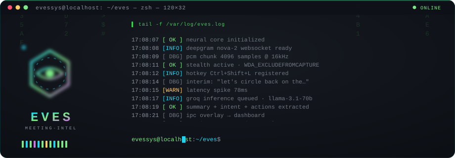
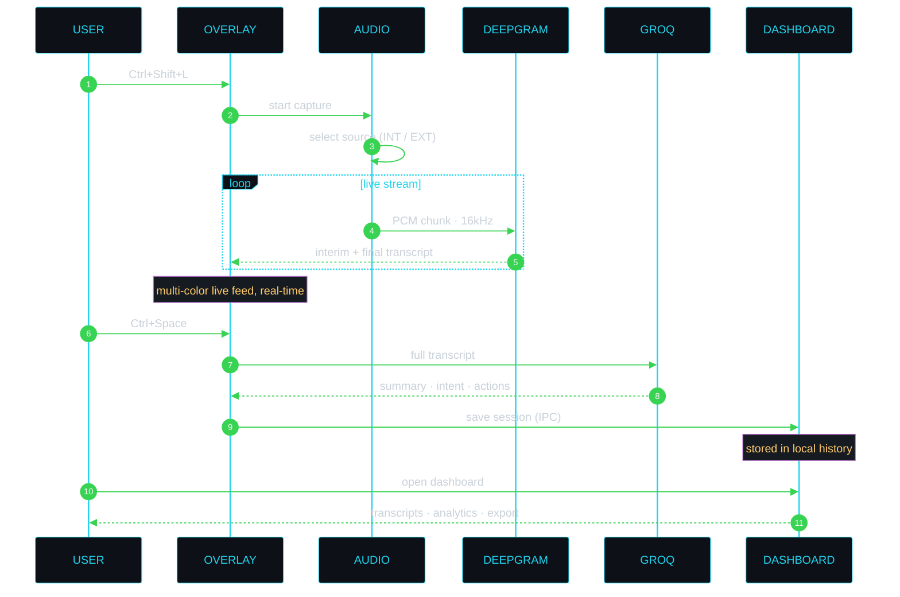

<!-- ╔═══════════════════════════════════════════════════════════════════════╗ -->
<!-- ║   EVES // MEETING INTELLIGENCE SYSTEM  ·  dark-web hacker edition       ║ -->
<!-- ╚═══════════════════════════════════════════════════════════════════════╝ -->

<div align="center">



<br/><br/>


<br/>


</div>

```bash
$ whoami
> EVES — the only meeting intelligence system that sees everything,
  and stays invisible while doing it.

$ ./eves --what
> Real-time transcription + AI summarization, entirely on YOUR machine
> Invisible on screen share  (SetWindowDisplayAffinity / content protection)
> Captures internal loopback (system audio) AND external mic
> Atom One Dark hacker HUD — matrix rain, scanlines, glassmorphism
> Deepgram nova-2  →  Groq LLaMA-3.1 70B  →  local history
> Zero cloud storage. Zero telemetry. They'll never know.
```

---

## ▌ NAVIGATION

<details open>
<summary><b><code>$ ls -la ./docs</code></b></summary>

- [`▸ LIVE ARCHITECTURE`](#-live-architecture) — the whole system, wired & flowing
- [`▸ REAL-TIME PIPELINE`](#-real-time-pipeline) — the capture → intel sequence
- [`▸ CORE CAPABILITIES`](#-core-capabilities) — the five modules
- [`▸ INTERFACE`](#-interface--atom-one-dark-hud) — the hacker UI
- [`▸ KEY BINDINGS`](#-key-bindings) — every hotkey
- [`▸ DEPLOYMENT`](#-deployment-vectors) — install & launch
- [`▸ PROJECT STRUCTURE`](#-project-structure) — the tree
- [`▸ TECH SPECS`](#-technical-specifications) — the stack

</details>

---

## ▌ LIVE ARCHITECTURE

> Every process wired together — watch the packets flow through the pipeline.

<div align="center">

</div>

```
LAUNCH ─▶ ELECTRON ─▶ AUDIO ─▶ DEEPGRAM ─▶ GROQ ─▶ DASHBOARD
   │         │  ╲                              │        ├─▶ Notion
 vbs/hta   overlay ╲──── stealth layer ────────┘        ├─▶ Drive
 /bat        hud     (invisible to screen share)        └─▶ History
```

---

## ▌ REAL-TIME PIPELINE

> What happens between `Ctrl+Shift+L` and a saved, analyzed session.



---

## ▌ CORE CAPABILITIES

```
┌─────────────────────────────────────────────────────────────────────────────────────┐
│  MODULE_01.DLL  ◆  AI TRANSCRIPTION                                                  │
│  ■ Deepgram nova-2 — real-time streaming WebSocket                                   │
│  ■ 16kHz PCM audio — internal loopback + external mic                                │
│  ■ Speaker diarization — knows who said what                                         │
│  ■ Smart formatting — punctuation, paragraphs, numbers                               │
│                                                                                       │
│  MODULE_02.DLL  ◆  STEALTH MODE                                                      │
│  ■ setContentProtection() — WDA_EXCLUDEFROMCAPTURE active                            │
│  ■ Invisible to: OBS, Zoom, Teams, Meet, Discord, screenshots                        │
│  ■ Removed from: taskbar, Alt+Tab, window switcher                                   │
│  ■ setIgnoreMouseEvents() — click-through mode                                       │
│                                                                                       │
│  MODULE_03.DLL  ◆  AUDIO CAPTURE                                                      │
│  ■ Internal: getDisplayMedia({ audio:'loopback' }) — system audio                    │
│  ■ External: getUserMedia() — microphone input                                       │
│  ■ Runtime source toggle — Ctrl+Shift+O                                              │
│                                                                                       │
│  MODULE_04.DLL  ◆  AI SUMMARIZATION                                                  │
│  ■ Groq LLaMA-3.1 70B — inference engine                                             │
│  ■ Summary — what was decided, what was avoided                                      │
│  ■ Intent detection — hidden agendas, unspoken concerns                              │
│  ■ Action items — who needs to do what by when                                       │
│                                                                                       │
│  MODULE_05.DLL  ◆  SESSION HISTORY                                                   │
│  ■ Full transcripts saved to dashboard via IPC                                       │
│  ■ AI summaries + intent + action items per session                                  │
│  ■ Ctrl+Space to save — auto-syncs to dashboard                                      │
└─────────────────────────────────────────────────────────────────────────────────────┘
```

---

## ▌ INTERFACE — ATOM ONE DARK HUD

> A top-0.1% hacker interface: charcoal glass, neon syntax colors, everything alive.

| Layer | What you get |
|:--|:--|
| **Theme** | Atom One Dark charcoal ramp (`#16181d → #282c34`) + neon syntax palette |
| **Logo** | Original hex-eye sigil — negative space reads as eye **and** "E", audio-equalizer pupil, sweeping scan line, orbiting node |
| **Backgrounds** | `CyberArt` procedural SVG — `neural · stealth · waveform · network · circuit · hexcore`. 100% self-contained, always renders (no external images) |
| **Panels** | Glassmorphism + hover-lift glow + **click-to-expand** full-screen modals |
| **System recon** | **Real** hardware telemetry — CPU threads, GPU, device memory, battery, network, JS heap, storage, timezone |
| **Live ops** | Threat map · packet sniffer · nmap port scan · AES cipher stream · data ticker |
| **FX** | Matrix rain, CRT scanlines, boot sequence, glitch text, radar sweep, live log feed |

```
  COLOR CHANNELS  ░▒▓█  cyan #22d3ee   green #7ee787   red #ff5370
                        yellow #ffcb6b  orange #f78c6c  blue #61afef  purple #c678dd
```

---

## ▌ KEY BINDINGS

| Keybind | Action | Effect |
|:--|:--|:--|
| `Ctrl + Shift + L` | Start / Stop listening | Toggles the audio capture pipeline |
| `Ctrl + Shift + A` | Hide / Show overlay | Keeps listening while hidden |
| `Ctrl + Shift + O` | Toggle audio source | Internal ↔ External mic |
| `Ctrl + Shift + T` | Toggle click-through | Mouse passes through the overlay |
| `Ctrl + Shift + D` | Show / Hide dashboard | Focus the main EVES dashboard |
| `Ctrl + Shift + S` | Toggle stealth mode | Invisible to screen share |
| `Ctrl + Space` | Save session to history | Transcript + summary saved |
| `Ctrl + Shift + X` | Quit EVES | Kills all processes |

---

## ▌ DEPLOYMENT VECTORS

```bash
# ── 1. clone ──────────────────────────────────────────────
git clone https://github.com/SHAILESH-RS-UPADHYAY/eves.git && cd eves

# ── 2. install (Electron 32, React 18, Deepgram, Groq, Zustand…) ──
npm install

# ── 3. configure keys ─────────────────────────────────────
#     Settings → api_keys → paste Deepgram + Groq → ./save_keys
#     Keys persist locally via Conf. Never sent anywhere but the APIs.

# ── 4. launch (Dashboard + Overlay) ───────────────────────
npm run dev

# ── 5. package → standalone installer ─────────────────────
npm run build      # → out/
npm run package    # → electron-builder installer
```

**Launch vectors** (Windows): `start.vbs` (zero visible terminal) · `start.hta` (animated) · `start.bat` (ASCII header) · `Launch EVES.bat` (one-click) · `stop.bat` (kill all).

---

## ▌ PROJECT STRUCTURE

```
evessys@machine:~$ tree eves/ --depth 2

eves/
├── electron/                     # Main process
│   ├── main.ts                   # windows, hotkeys, IPC, tray, stealth
│   ├── preload.ts                # contextBridge → window.eves.*
│   └── ipc/                      # deepgram · groq · drive · notion · settings
│
├── overlay/                      # Overlay HUD (plain HTML/CSS/JS)
│   ├── index.html · app.js · styles.css
│
├── src/                          # Dashboard (React + TS)
│   ├── App.tsx  main.tsx
│   ├── components/
│   │   ├── brand/                # ◆ EvesLogo.tsx  (the hex-eye sigil)
│   │   ├── hacker/               # CyberArt · CyberKit · HackerPanels
│   │   │                         #   MatrixRain · Scanlines · BootSequence
│   │   │                         #   GlitchText · RadarSweep · SystemStatus
│   │   ├── dashboard/            # DashboardPage + feeds
│   │   ├── integrations/         # IntegrationsPage (uplink matrix)
│   │   ├── meeting/              # TranscriptsPage (signal intercept)
│   │   ├── settings/             # ControlPanelPage (system recon)
│   │   ├── layout/               # Sidebar · TopBar · AppShell
│   │   └── glass/                # glass UI primitives
│   ├── store/                    # Zustand stores
│   ├── styles/                   # globals.css (Atom One Dark) + animations
│   └── types/                    # TS interfaces
│
├── docs/                         # ◆ animated SVGs (hero + architecture)
├── launcher/                     # start.vbs · start.hta · *.bat
├── package.json · README.md
```

---

## ▌ HACKER COMPONENT LIBRARY

```
src/components/brand/
  EvesLogo.tsx       ◆ Original hex-eye sigil — gradient stroke, equalizer
                     ◆ pupil, sweeping scan line, orbiting node, HUD ticks

src/components/hacker/
  CyberArt.tsx       ◆ Procedural animated SVG backdrops (6 variants)
                     ◆ neural · stealth · waveform · network · circuit · hexcore
                     ◆ zero external assets — always renders offline

  CyberKit.tsx       ◆ ExpandableCard (hover-lift + click-to-enlarge modal)
                     ◆ SystemRecon — REAL laptop telemetry (CPU/GPU/mem/net…)
                     ◆ ConnectionMatrix · ConfigConsole · DecryptStandby

  HackerPanels.tsx   ◆ PacketSniffer · PortScan · ThreatMap
                     ◆ CipherStream (AES) · DataTicker · AsciiBanner

  MatrixRain.tsx     ◆ Canvas katakana + hex rain, green glow trails
  Scanlines.tsx      ◆ CRT lines + moving scan beam + vignette
  BootSequence.tsx   ◆ Full-screen terminal boot animation
  GlitchText.tsx     ◆ RGB-split glitch headline
  RadarSweep.tsx     ◆ Rotating radar SVG + contact blips
  SystemStatus.tsx   ◆ Live CPU / MEM / NET / latency bars
  LiveLogFeed.tsx    ◆ Scrolling [INFO]/[WARN]/[DEBUG] log stream
```

---

## ▌ TECHNICAL SPECIFICATIONS

| Layer | Stack |
|:--|:--|
| **Framework** | Electron 32 · React 18 · TypeScript 5.5 |
| **Build** | electron-vite 2.3 → `out/` |
| **State** | Zustand 5 (renderer) · Conf 10 (main-process store) |
| **Animation** | Framer Motion 11 · CSS keyframes · SMIL SVG |
| **Charts** | Recharts 2 (sparklines + stats) |
| **Audio** | Web Audio API (ScriptProcessor) · Deepgram WebSocket SDK |
| **AI** | Groq SDK — LLaMA-3.1 70B (summary · intent · actions) |
| **Storage** | Conf 10 → local JSON (keys, settings, window bounds) |
| **Stealth** | setContentProtection · skipTaskbar · WS_EX_TOOLWINDOW · click-through |
| **Theme** | Atom One Dark — `#16181d/#21252b/#282c34` + neon syntax palette |
| **License** | MIT |

---

## ▌ DEPENDENCIES

```
$ npm ls --depth=0

eves@1.0.0
├── @deepgram/sdk@^3.6.0          # transcription SDK
├── @tanstack/react-query@^5.56   # async state
├── conf@^10.2.0                  # persistent config store
├── framer-motion@^11.5           # animations
├── groq-sdk@^0.7.0               # Groq AI inference
├── lucide-react@^0.447           # icons
├── react@^18.3.0  react-dom      # UI
├── react-dropzone@^14.2          # file upload
├── react-hotkeys-hook@^4.5       # hotkeys
├── recharts@^2.12                # charts
├── wavesurfer.js@^7.8            # audio waveform
└── zustand@^5.0.0                # state management
```

---

<div align="center">


<br/>


</div>
